# Note Lifecycle State Machine & Decision Tables

> This document is generated from source code. Do not edit manually.
> Run `pnpm run doc:state-machine` to regenerate.

## 1. State Machine Topology

**Location:** `src/services/notes/lifecycle.ts:47-79`  
**11 states, 13 events, ~30 transitions**

This is the **single source of truth** for legal state transitions. The xstate machine, Mermaid diagram, and runtime validation all derive from this table.

```mermaid
stateDiagram-v2
  direction TB
  [*] --> ankiOnly_neverImported
  ankiOnly_neverImported["ankiOnly.neverImported"]
  ankiOnly_fileDeleted["ankiOnly.fileDeleted"]
  synced_clean["synced.clean"]
  synced_ankiNewer["synced.ankiNewer"]
  synced_vaultNewer["synced.vaultNewer"]
  synced_diverged["synced.diverged"]
  linked_unenrolled["linked.unenrolled"]
  vaultOnly_unexported["vaultOnly.unexported"]
  vaultOnly_unenrolled["vaultOnly.unenrolled"]
  vaultOnly_ankiDeleted["vaultOnly.ankiDeleted"]
  orphaned["orphaned"]
  ankiOnly_neverImported --> synced_clean: IMPORT
  ankiOnly_neverImported --> ankiOnly_neverImported: SKIP
  ankiOnly_fileDeleted --> synced_ankiNewer: RESURRECT
  ankiOnly_fileDeleted --> orphaned: PURGE
  synced_clean --> synced_clean: CHECK
  synced_ankiNewer --> synced_clean: PULL
  synced_ankiNewer --> synced_clean: FORCE_PUSH
  synced_vaultNewer --> synced_clean: PUSH
  synced_vaultNewer --> synced_clean: FORCE_PULL
  synced_vaultNewer --> synced_clean: RESOLVE_NEWEST
  synced_diverged --> synced_clean: FORCE_PULL
  synced_diverged --> synced_clean: FORCE_PUSH
  synced_diverged --> synced_clean: RESOLVE_NEWEST
  linked_unenrolled --> synced_clean: ENROLL
  vaultOnly_unexported --> synced_clean: EXPORT
  vaultOnly_unenrolled --> synced_clean: ENROLL
  vaultOnly_ankiDeleted --> orphaned: DELETE_FILE
  vaultOnly_ankiDeleted --> synced_clean: EXPORT
  orphaned --> orphaned: PURGE
```

## 2. Decision Tables — Command Policies

**Location:** `src/services/notes/decision-table.ts`  
**1 canonical decision × 11 states, projected into 3 command tables = 33 rows**

This is the **second independent authority**. One canonical table per state defines what each command (import/export/sync) does in that state — which event to emit, whether force changes it, which component is responsible, and why. The three command tables are derived from it at runtime.

### 1. Export Wizard (force)

```mermaid
flowchart TB
  subgraph COMMAND[Command]
  direction TB
    Export["Export (forced)"]
  end

  subgraph STATES[States]
  direction TB
    ankiOnly_neverImported["ankiOnly.neverImported"]
    ankiOnly_fileDeleted["ankiOnly.fileDeleted"]
    synced_clean["synced.clean"]
    synced_ankiNewer["synced.ankiNewer"]
    synced_vaultNewer["synced.vaultNewer"]
    synced_diverged["synced.diverged"]
    linked_unenrolled["linked.unenrolled"]
    vaultOnly_unexported["vaultOnly.unexported"]
    vaultOnly_unenrolled["vaultOnly.unenrolled"]
    vaultOnly_ankiDeleted["vaultOnly.ankiDeleted"]
    orphaned["orphaned"]
  end

  Export -->|start| START["[*]"]

  Export -->|"—<br/>create · create-from-anki<br/>Anki only: the import wizard brings it in."| ankiOnly_neverImported
  Export -->|"—<br/>missing · bidirectional-sync<br/>File gone: Sync decides, nothing to push."| ankiOnly_fileDeleted
  Export -->|"CHECK<br/>quiet · bidirectional-sync<br/>Both sides match: nothing to write."| synced_clean
  Export -->|"— / FORCE_PUSH (force)<br/>skip · bidirectional-sync<br/>force: FORCE_PUSH<br/>Newer in Anki: skipped, use Sync. Forced: overwrites Anki."| synced_ankiNewer
  synced_ankiNewer -.->|"forced: FORCE_PUSH"| Export
  Export -->|"PUSH<br/>overwrite · create-in-anki<br/>Newer in Obsidian: pushes to Anki."| synced_vaultNewer
  Export -->|"— / FORCE_PUSH (force)<br/>conflict · bidirectional-sync<br/>force: FORCE_PUSH<br/>Edited in both: skipped, use Sync. Forced: overwrites Anki."| synced_diverged
  synced_diverged -.->|"forced: FORCE_PUSH"| Export
  Export -->|"ENROLL<br/>quiet · enroll-in-anki<br/>Has an id but no record: enrols it, writes nothing."| linked_unenrolled
  Export -->|"EXPORT<br/>create · create-in-anki<br/>Vault only: creates the Anki note, writes the id back."| vaultOnly_unexported
  Export -->|"ENROLL<br/>quiet · enroll-in-anki<br/>Has an id but no record: enrols it, writes nothing."| vaultOnly_unenrolled
  Export -->|"— / EXPORT (force)<br/>missing · bidirectional-sync<br/>force: EXPORT<br/>Gone from Anki: Sync applies the deletion. Forced: re-creates it in Anki."| vaultOnly_ankiDeleted
  vaultOnly_ankiDeleted -.->|"forced: EXPORT"| Export
  Export -->|"—<br/>missing · cleanup-vault<br/>Only a stale record left: Purge ledger forgets it."| orphaned

  Export -->|end| END["[*]"]

  classDef cmd fill:#e8eaf6,stroke:#283593,stroke-width:2px,color:#1a237e;
  classDef state fill:#fce4ec,stroke:#ad1457,stroke-width:1px,color:#880e4f;
  class Export cmd;
  class ankiOnly_neverImported state;
  class ankiOnly_fileDeleted state;
  class synced_clean state;
  class synced_ankiNewer state;
  class synced_vaultNewer state;
  class synced_diverged state;
  class linked_unenrolled state;
  class vaultOnly_unexported state;
  class vaultOnly_unenrolled state;
  class vaultOnly_ankiDeleted state;
  class orphaned state;
```

### 2. Import Wizard (force)

```mermaid
flowchart TB
  subgraph COMMAND[Command]
  direction TB
    Import["Import (forced)"]
  end

  subgraph STATES[States]
  direction TB
    ankiOnly_neverImported["ankiOnly.neverImported"]
    ankiOnly_fileDeleted["ankiOnly.fileDeleted"]
    synced_clean["synced.clean"]
    synced_ankiNewer["synced.ankiNewer"]
    synced_vaultNewer["synced.vaultNewer"]
    synced_diverged["synced.diverged"]
    linked_unenrolled["linked.unenrolled"]
    vaultOnly_unexported["vaultOnly.unexported"]
    vaultOnly_unenrolled["vaultOnly.unenrolled"]
    vaultOnly_ankiDeleted["vaultOnly.ankiDeleted"]
    orphaned["orphaned"]
  end

  Import -->|start| START["[*]"]

  Import -->|"IMPORT<br/>create · create-from-anki<br/>Anki only: creates the file."| ankiOnly_neverImported
  Import -->|"— / RESURRECT (force)<br/>missing · bidirectional-sync<br/>force: RESURRECT<br/>File gone: Sync decides, forcing re-creates it. Forced: re-creates the file you deleted."| ankiOnly_fileDeleted
  ankiOnly_fileDeleted -.->|"forced: RESURRECT"| Import
  Import -->|"CHECK<br/>quiet · bidirectional-sync<br/>Both sides match: rewrites nothing. Forced: rewrites the same content."| synced_clean
  Import -->|"PULL<br/>overwrite · bidirectional-sync<br/>Newer in Anki: overwrites your file."| synced_ankiNewer
  Import -->|"— / FORCE_PULL (force)<br/>skip · create-in-anki<br/>force: FORCE_PULL<br/>Newer in Obsidian: skipped, use Sync. Forced: overwrites your newer edits."| synced_vaultNewer
  synced_vaultNewer -.->|"forced: FORCE_PULL"| Import
  Import -->|"— / FORCE_PULL (force)<br/>conflict · bidirectional-sync<br/>force: FORCE_PULL<br/>Edited in both: newest wins on Sync. Forced: overwrites your newer edits."| synced_diverged
  synced_diverged -.->|"forced: FORCE_PULL"| Import
  Import -->|"ENROLL<br/>quiet · enroll-in-anki<br/>Has an id but no record: enrols it, rewrites the same file."| linked_unenrolled
  Import -->|"—<br/>create · create-in-anki<br/>Vault only: the export wizard creates it."| vaultOnly_unexported
  Import -->|"ENROLL<br/>quiet · enroll-in-anki<br/>Has an id but no record: enrols it, rewrites the same file."| vaultOnly_unenrolled
  Import -->|"—<br/>missing · bidirectional-sync<br/>Gone from Anki: Sync deletes the file."| vaultOnly_ankiDeleted
  Import -->|"—<br/>missing · cleanup-vault<br/>Only a stale record left: Purge ledger forgets it."| orphaned

  Import -->|end| END["[*]"]

  classDef cmd fill:#e8eaf6,stroke:#283593,stroke-width:2px,color:#1a237e;
  classDef state fill:#fce4ec,stroke:#ad1457,stroke-width:1px,color:#880e4f;
  class Import cmd;
  class ankiOnly_neverImported state;
  class ankiOnly_fileDeleted state;
  class synced_clean state;
  class synced_ankiNewer state;
  class synced_vaultNewer state;
  class synced_diverged state;
  class linked_unenrolled state;
  class vaultOnly_unexported state;
  class vaultOnly_unenrolled state;
  class vaultOnly_ankiDeleted state;
  class orphaned state;
```

### 3. Sync Command (no force)

```mermaid
flowchart TB
  subgraph COMMAND[Command]
  direction TB
    Sync["Sync (no force)"]
  end

  subgraph STATES[States]
  direction TB
    ankiOnly_neverImported["ankiOnly.neverImported"]
    ankiOnly_fileDeleted["ankiOnly.fileDeleted"]
    synced_clean["synced.clean"]
    synced_ankiNewer["synced.ankiNewer"]
    synced_vaultNewer["synced.vaultNewer"]
    synced_diverged["synced.diverged"]
    linked_unenrolled["linked.unenrolled"]
    vaultOnly_unexported["vaultOnly.unexported"]
    vaultOnly_unenrolled["vaultOnly.unenrolled"]
    vaultOnly_ankiDeleted["vaultOnly.ankiDeleted"]
    orphaned["orphaned"]
  end

  Sync -->|start| START["[*]"]

  Sync -->|"—<br/>create · create-from-anki<br/>Untracked Anki note: counted as needing import."| ankiOnly_neverImported
  Sync -->|"RESURRECT<br/>missing · bidirectional-sync<br/>No file: Sync resurrects it when Anki changed after the deletion, otherwise forgets it."| ankiOnly_fileDeleted
  Sync -->|"CHECK<br/>quiet · bidirectional-sync<br/>Both sides match: nothing to do."| synced_clean
  Sync -->|"PULL<br/>overwrite · bidirectional-sync<br/>Newer in Anki: refreshes the vault file."| synced_ankiNewer
  Sync -->|"PUSH<br/>overwrite · create-in-anki<br/>Newer in Obsidian: pushes to Anki."| synced_vaultNewer
  Sync -->|"RESOLVE_NEWEST<br/>conflict · bidirectional-sync<br/>Edited in both: the newer side wins."| synced_diverged
  Sync -->|"—<br/>quiet · enroll-in-anki<br/>Enrolling is the wizards' job."| linked_unenrolled
  Sync -->|"—<br/>create · create-in-anki<br/>Vault only: the export wizard creates it."| vaultOnly_unexported
  Sync -->|"—<br/>quiet · enroll-in-anki<br/>Enrolling is the wizards' job."| vaultOnly_unenrolled
  Sync -->|"DELETE_FILE<br/>missing · bidirectional-sync<br/>Gone from Anki: Sync removes the block from the vault."| vaultOnly_ankiDeleted
  Sync -->|"—<br/>missing · cleanup-vault<br/>Only a stale record left: Purge ledger forgets it."| orphaned

  Sync -->|end| END["[*]"]

  classDef cmd fill:#e8eaf6,stroke:#283593,stroke-width:2px,color:#1a237e;
  classDef state fill:#fce4ec,stroke:#ad1457,stroke-width:1px,color:#880e4f;
  class Sync cmd;
  class ankiOnly_neverImported state;
  class ankiOnly_fileDeleted state;
  class synced_clean state;
  class synced_ankiNewer state;
  class synced_vaultNewer state;
  class synced_diverged state;
  class linked_unenrolled state;
  class vaultOnly_unexported state;
  class vaultOnly_unenrolled state;
  class vaultOnly_ankiDeleted state;
  class orphaned state;
```

#### Decision Table (Markdown) — State-Centric (Transposed)

| State | Export (forced) | Import (forced) | Sync (no force) |
|-------|--------------------|------------------------|-----------------|
| `ankiOnly.neverImported` | `—` create · create-from-anki Anki only: the import wizard brings it in. | `IMPORT` create · create-from-anki Anki only: creates the file. | `—` create · create-from-anki Untracked Anki note: counted as needing import. |
| `ankiOnly.fileDeleted` | `—` missing · bidirectional-sync File gone: Sync decides, nothing to push. | `—` / `RESURRECT` (force) missing · bidirectional-sync **Force:** RESURRECT File gone: Sync decides, forcing re-creates it. Forced: re-creates the file you deleted. | `RESURRECT` missing · bidirectional-sync No file: Sync resurrects it when Anki changed after the deletion, otherwise forgets it. |
| `synced.clean` | `CHECK` quiet · bidirectional-sync Both sides match: nothing to write. | `CHECK` quiet · bidirectional-sync Both sides match: rewrites nothing. Forced: rewrites the same content. | `CHECK` quiet · bidirectional-sync Both sides match: nothing to do. |
| `synced.ankiNewer` | `—` / `FORCE_PUSH` (force) skip · bidirectional-sync **Force:** FORCE_PUSH Newer in Anki: skipped, use Sync. Forced: overwrites Anki. | `PULL` overwrite · bidirectional-sync Newer in Anki: overwrites your file. | `PULL` overwrite · bidirectional-sync Newer in Anki: refreshes the vault file. |
| `synced.vaultNewer` | `PUSH` overwrite · create-in-anki Newer in Obsidian: pushes to Anki. | `—` / `FORCE_PULL` (force) skip · create-in-anki **Force:** FORCE_PULL Newer in Obsidian: skipped, use Sync. Forced: overwrites your newer edits. | `PUSH` overwrite · create-in-anki Newer in Obsidian: pushes to Anki. |
| `synced.diverged` | `—` / `FORCE_PUSH` (force) conflict · bidirectional-sync **Force:** FORCE_PUSH Edited in both: skipped, use Sync. Forced: overwrites Anki. | `—` / `FORCE_PULL` (force) conflict · bidirectional-sync **Force:** FORCE_PULL Edited in both: newest wins on Sync. Forced: overwrites your newer edits. | `RESOLVE_NEWEST` conflict · bidirectional-sync Edited in both: the newer side wins. |
| `linked.unenrolled` | `ENROLL` quiet · enroll-in-anki Has an id but no record: enrols it, writes nothing. | `ENROLL` quiet · enroll-in-anki Has an id but no record: enrols it, rewrites the same file. | `—` quiet · enroll-in-anki Enrolling is the wizards' job. |
| `vaultOnly.unexported` | `EXPORT` create · create-in-anki Vault only: creates the Anki note, writes the id back. | `—` create · create-in-anki Vault only: the export wizard creates it. | `—` create · create-in-anki Vault only: the export wizard creates it. |
| `vaultOnly.unenrolled` | `ENROLL` quiet · enroll-in-anki Has an id but no record: enrols it, writes nothing. | `ENROLL` quiet · enroll-in-anki Has an id but no record: enrols it, rewrites the same file. | `—` quiet · enroll-in-anki Enrolling is the wizards' job. |
| `vaultOnly.ankiDeleted` | `—` / `EXPORT` (force) missing · bidirectional-sync **Force:** EXPORT Gone from Anki: Sync applies the deletion. Forced: re-creates it in Anki. | `—` missing · bidirectional-sync Gone from Anki: Sync deletes the file. | `DELETE_FILE` missing · bidirectional-sync Gone from Anki: Sync removes the block from the vault. |
| `orphaned` | `—` missing · cleanup-vault Only a stale record left: Purge ledger forgets it. | `—` missing · cleanup-vault Only a stale record left: Purge ledger forgets it. | `—` missing · cleanup-vault Only a stale record left: Purge ledger forgets it. |

Command-Centric Tables (per command)

### export (forced)

| state | kind | default | forced | responsibleComponent | why |
| --- | --- | --- | --- | --- | --- |
| `ankiOnly.neverImported` | `create` | `—` | `—` | `create-from-anki` | Anki only: the import wizard brings it in. |
| `ankiOnly.fileDeleted` | `missing` | `—` | `—` | `bidirectional-sync` | File gone: Sync decides, nothing to push. |
| `synced.clean` | `quiet` | `CHECK` | `—` | `bidirectional-sync` | Both sides match: nothing to write. |
| `synced.ankiNewer` | `skip` | `—` | `FORCE_PUSH` | `bidirectional-sync` | Newer in Anki: skipped, use Sync. Forced: overwrites Anki. |
| `synced.vaultNewer` | `overwrite` | `PUSH` | `—` | `create-in-anki` | Newer in Obsidian: pushes to Anki. |
| `synced.diverged` | `conflict` | `—` | `FORCE_PUSH` | `bidirectional-sync` | Edited in both: skipped, use Sync. Forced: overwrites Anki. |
| `linked.unenrolled` | `quiet` | `ENROLL` | `—` | `enroll-in-anki` | Has an id but no record: enrols it, writes nothing. |
| `vaultOnly.unexported` | `create` | `EXPORT` | `—` | `create-in-anki` | Vault only: creates the Anki note, writes the id back. |
| `vaultOnly.unenrolled` | `quiet` | `ENROLL` | `—` | `enroll-in-anki` | Has an id but no record: enrols it, writes nothing. |
| `vaultOnly.ankiDeleted` | `missing` | `—` | `EXPORT` | `bidirectional-sync` | Gone from Anki: Sync applies the deletion. Forced: re-creates it in Anki. |
| `orphaned` | `missing` | `—` | `—` | `cleanup-vault` | Only a stale record left: Purge ledger forgets it. |

### import (forced)

| state | kind | default | forced | responsibleComponent | why |
| --- | --- | --- | --- | --- | --- |
| `ankiOnly.neverImported` | `create` | `IMPORT` | `—` | `create-from-anki` | Anki only: creates the file. |
| `ankiOnly.fileDeleted` | `missing` | `—` | `RESURRECT` | `bidirectional-sync` | File gone: Sync decides, forcing re-creates it. Forced: re-creates the file you deleted. |
| `synced.clean` | `quiet` | `CHECK` | `—` | `bidirectional-sync` | Both sides match: rewrites nothing. Forced: rewrites the same content. |
| `synced.ankiNewer` | `overwrite` | `PULL` | `—` | `bidirectional-sync` | Newer in Anki: overwrites your file. |
| `synced.vaultNewer` | `skip` | `—` | `FORCE_PULL` | `create-in-anki` | Newer in Obsidian: skipped, use Sync. Forced: overwrites your newer edits. |
| `synced.diverged` | `conflict` | `—` | `FORCE_PULL` | `bidirectional-sync` | Edited in both: newest wins on Sync. Forced: overwrites your newer edits. |
| `linked.unenrolled` | `quiet` | `ENROLL` | `—` | `enroll-in-anki` | Has an id but no record: enrols it, rewrites the same file. |
| `vaultOnly.unexported` | `create` | `—` | `—` | `create-in-anki` | Vault only: the export wizard creates it. |
| `vaultOnly.unenrolled` | `quiet` | `ENROLL` | `—` | `enroll-in-anki` | Has an id but no record: enrols it, rewrites the same file. |
| `vaultOnly.ankiDeleted` | `missing` | `—` | `—` | `bidirectional-sync` | Gone from Anki: Sync deletes the file. |
| `orphaned` | `missing` | `—` | `—` | `cleanup-vault` | Only a stale record left: Purge ledger forgets it. |

### sync (no force)

| state | kind | default | forced | responsibleComponent | why |
| --- | --- | --- | --- | --- | --- |
| `ankiOnly.neverImported` | `create` | `—` | `—` | `create-from-anki` | Untracked Anki note: counted as needing import. |
| `ankiOnly.fileDeleted` | `missing` | `RESURRECT` | `—` | `bidirectional-sync` | No file: Sync resurrects it when Anki changed after the deletion, otherwise forgets it. |
| `synced.clean` | `quiet` | `CHECK` | `—` | `bidirectional-sync` | Both sides match: nothing to do. |
| `synced.ankiNewer` | `overwrite` | `PULL` | `—` | `bidirectional-sync` | Newer in Anki: refreshes the vault file. |
| `synced.vaultNewer` | `overwrite` | `PUSH` | `—` | `create-in-anki` | Newer in Obsidian: pushes to Anki. |
| `synced.diverged` | `conflict` | `RESOLVE_NEWEST` | `—` | `bidirectional-sync` | Edited in both: the newer side wins. |
| `linked.unenrolled` | `quiet` | `—` | `—` | `enroll-in-anki` | Enrolling is the wizards' job. |
| `vaultOnly.unexported` | `create` | `—` | `—` | `create-in-anki` | Vault only: the export wizard creates it. |
| `vaultOnly.unenrolled` | `quiet` | `—` | `—` | `enroll-in-anki` | Enrolling is the wizards' job. |
| `vaultOnly.ankiDeleted` | `missing` | `DELETE_FILE` | `—` | `bidirectional-sync` | Gone from Anki: Sync removes the block from the vault. |
| `orphaned` | `missing` | `—` | `—` | `cleanup-vault` | Only a stale record left: Purge ledger forgets it. |

---

*Generated by `pnpm run doc:state-machine` from `src/dev/print-state-machine.ts`*
